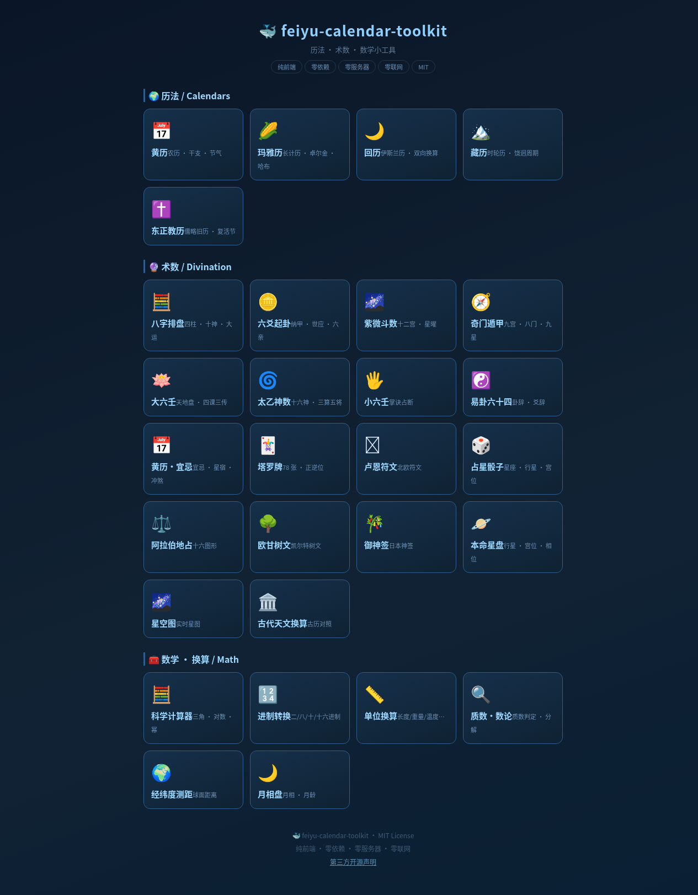
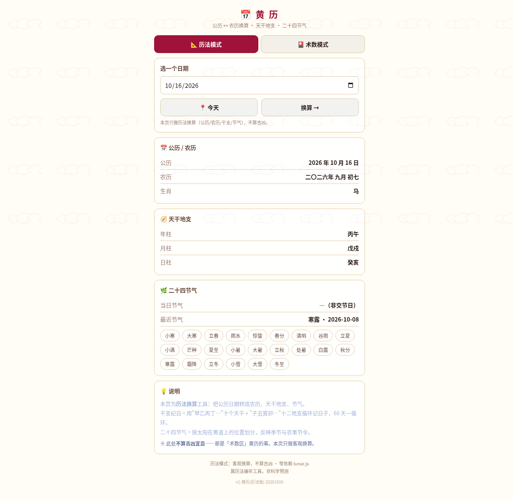
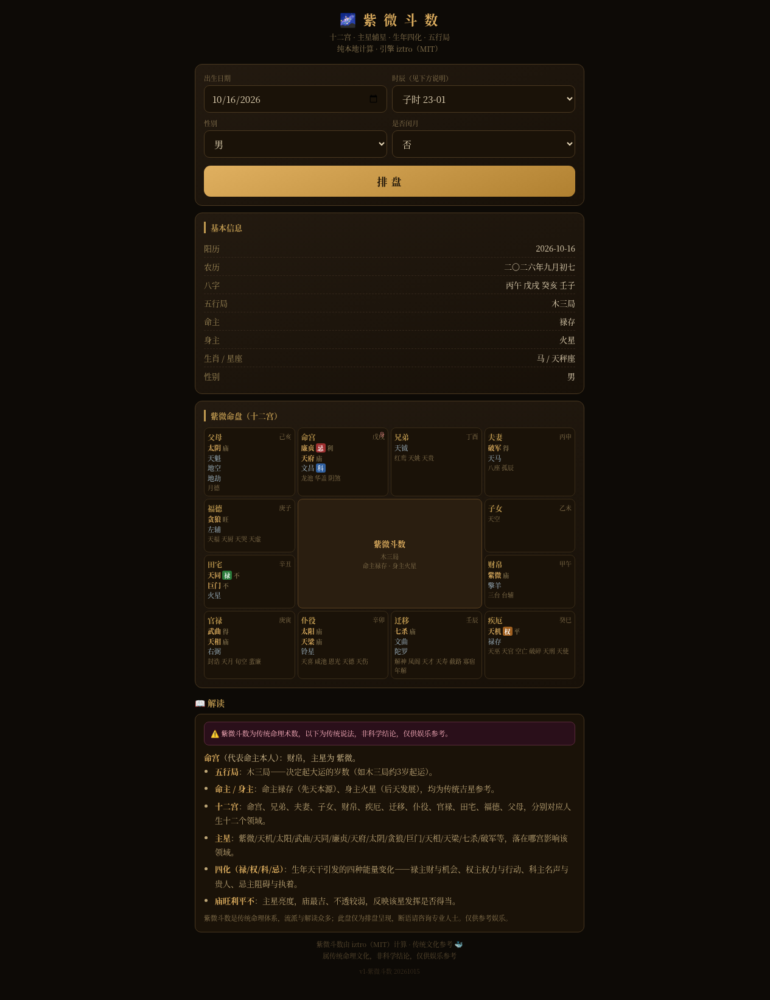
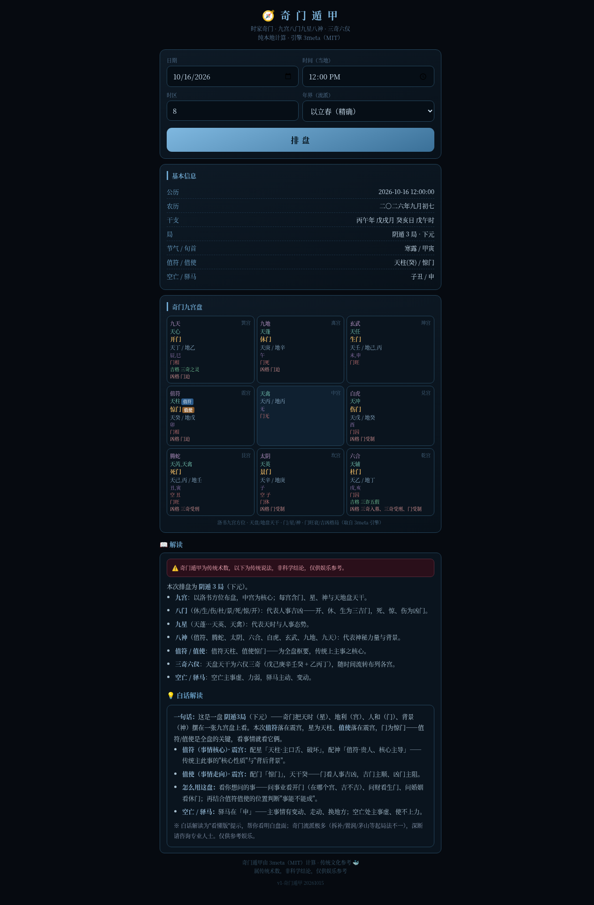

<h1 align="center">📦 肥鱼主流历法与术数工具箱</h1>

<h3 align="center">feiyu-calendar-toolkit</h3>

<p align="center">
  
  
  
</p>

---

<p align="center">
  <b>🌐 在线试玩：<a href="https://feiyu-whale.github.io/feiyu-calendar-toolkit/">feiyu-whale.github.io/feiyu-calendar-toolkit</a></b><br>
  <sub>（纯前端 · 零依赖 · 打开即用）</sub>
</p>

<p align="center">
  
  &nbsp;
  
</p>
<p align="center">
  
  
  
</p>

一个**纯前端、零依赖、即开即用**的开源集成工具。涵盖主流的东方历法（黄历/藏历）、西方历法（公历/东正教）、美洲古历（玛雅历）、伊斯兰历（回历），以及主流的中西方术数排盘（八字、紫微、奇门、大六壬、太乙、星盘、塔罗等）。

我们只收录**目前仍在使用、且具有广泛文化影响力**的历法与术数体系，**绝不堆砌冗杂或死去的历法**。

---

## ✨ 特点

- **零依赖**：所有核心计算内联在页面里，不加载任何外部 CDN / 字体 / 图片。
- **零服务器**：纯静态 HTML/JS/CSS，双击即用，也可托管在任何静态空间。
- **零联网**：不使用任何 `fetch` / `XMLHttpRequest`，不采集任何数据。
- **不上传任何用户数据**：本项目纯前端运行，所有计算均在浏览器本地完成，**绝不上传任何用户数据**。因此，涉及**图像识别**的面相 / 手相等功能**未包含在内**。
- **纯数学**：历法换算、天文计算、术数排盘均基于公开算法与学术论文实现。

---

## 📦 内容

### 🌍 历法 / Calendars
| 工具 | 说明 |
|---|---|
| 📅 黄历 | 公历 ⇄ 农历、干支、二十四节气（含"术数版"宜忌/星宿/冲煞）|
| 🌽 玛雅历 | 长计历 · 卓尔金历 · 哈布历 · 历法轮，双向换算 |
| 🌙 回历 | 伊斯兰历（希吉来历）双向换算 |
| 🏔️ 藏历 | 时轮历（普巴派）· 饶迥周期 · 闰月闰日 |
| ✝️ 东正教历 | 儒略历（旧历）换算 · 复活节算法 |

### 🔮 术数 / Divination
八字排盘 · 六爻起卦 · 紫微斗数 · 奇门遁甲 · 大六壬 · 太乙神数 · 小六壬 · 易卦六十四 ·
塔罗牌 · 卢恩符文 · 占星骰子 · 阿拉伯地占 · 欧甘树文 · 御神签 · 本命星盘 · 星空图 · 古代天文换算

### 🧰 数学 / 换算 / Math & Conversion
科学计算器 · 进制转换 · 单位换算 · 质数·数论 · 经纬度测距 · 月相盘 · 古今度量衡 · 时间戳转换 · 编码解码 · 哈希 · 随机生成 · 颜色工具

### 🔧 专业深度工具箱（开发中）
电气与工控 · 轻量逻辑仿真 · 工程力学 · 声学与光学 · 化学与材料 · 财务会计 · 高级数据
（详见 [pro-tools/](pro-tools/)，模块陆续上线）

---

## 📝 更新日志 / Changelog

> 项目持续更新中 🐳

### 2026-10-16
- 🔧 **新增「专业深度工具箱」专区**（开发中）：电气/工控 · 逻辑仿真 · 力学 · 声光 · 化学材料 · 财务 · 高级数据
- 🧮 **新增 5 个工具**：时间戳转换 · 编码解码(Base64/URL/JWT) · 哈希(SHA-1/256/512) · 随机生成(UUID/密码) · 颜色工具(HEX/RGB/HSL)
- 📐 **新增「古今度量衡」**：中国历代长度/容量/重量换算（商→周→秦汉→唐→宋→元→明清→市制）

### 2026-10-15
- 新增「工具区」独立分区，与历法/术数拆分
- 历法区扩充：玛雅历 · 回历 · 藏历 · 东正教历

### 2026-10-14
- 术数区扩充与正统性核查（塔罗补全小阿卡纳 · 欧甘回归标准 20 符 · 卢恩改用真 merkstave）
- 新增模拟金融专区

---

## 🚀 使用

```bash
# 方式一：直接打开
open index.html

# 方式二：本地静态服务器（任意一个都行）
python3 -m http.server 8080
```

然后浏览器访问对应页面即可。**无需安装、无需构建。**

---

## 🧮 算法与数据来源

本项目的历法与天文计算，建立在以下**公开、开源、学术**成果之上（详见
[THIRD-PARTY-NOTICES.md](THIRD-PARTY-NOTICES.md)）：

- **lunar-javascript**（6tail，MIT）—— 农历 / 干支 / 节气基座
- **iztro**（MIT）—— 紫微斗数
- **3meta**（MIT）—— 奇门遁甲
- **mingpan**（Apache-2.0）—— 大六壬
- **react-taiyi / kintaiyi**（MIT）—— 太乙神数
- **celestine**（MIT）—— 西洋占星
- **@hnw/date-tibetan**（MIT）—— 藏历（算法据 Svante Janson《Tibetan calendar mathematics》）

玛雅历、回历、东正教历为**纯算法实现**（儒略日 JDN 桥梁 / 浏览器原生 Intl）。

---

## 🧭 换算基准说明（重要）

> 历法换算最容易翻车的地方**不是闰年，而是时区**。为避免歧义，本工具箱的基准口径如下：

- **输入基准**：所有历法换算**均以「输入的年-月-日」为基准，不涉具体时刻**；
- **内部换算**：优先采用**纯数学儒略日（JDN）**（玛雅、东正教），**不依赖浏览器时区**；
- **回历 / 藏历**：使用 `Date.UTC` 基准（**UTC+0**），输入日期按**该日日界**处理；
- ⚠️ **已知差异**：在**午夜前后**使用页面「今天」按钮时，浏览器本地时区（如 UTC+8）与内部 UTC 基准**可能相差 1 天**——此为**已知项**，正在评估统一。
- **审查建议**：请以「对给定输入日期的换算正确性」为审查重点；**跨时区显示差异属已知项**。

---

## 📄 许可

本项目采用 **MIT License**（见 [LICENSE](LICENSE)）。

第三方依赖各自的许可原文收录于 [`LICENSES/`](LICENSES/)，并汇总于
[THIRD-PARTY-NOTICES.md](THIRD-PARTY-NOTICES.md)。

---

## ⚠️ 免责声明

术数 / 命理内容属**传统文化**范畴，**非科学结论**，仅供文化娱乐与学习参考，
请勿据以做重大决定。历法换算基于公开算法，个别流派或口径可能存在细微差异。

---

🐳 Made with care.
